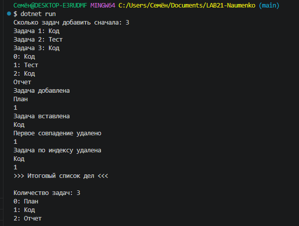

# Практическая работа №21

Автор: Семён Науменко 
Группа: ИСП-251

## Тема

Коллекция List в C#.

## Что реализовано

- ввод и вывод списка задач;
- добавление и вставка;
- удаление по значению и индексу;
- поиск первого совпадения;
- проверка допустимости индексов;
- обработка пустого списка.

## Короткие ответы

1. Чем List отличается от массива и как узнать количество элементов списка?

Ответ: список умеет автоматически менять свой размер, а массив нет. Чтоыб узнать кол-во элементов списка использовать надо .Count

2. Чем отличаются Remove() и RemoveAt()?

Ответ: Remove() - удаляет по самому значению. RemoveAt()-по индексу
3. Почему для вставки допустим индекс Count, а для удаления — нет?

Ответ: Потому что Count указывает на индекс + 1 в списке, добавить значения на новый индекс можно, а удалить, то чего нет, нельзя.

## Результат

